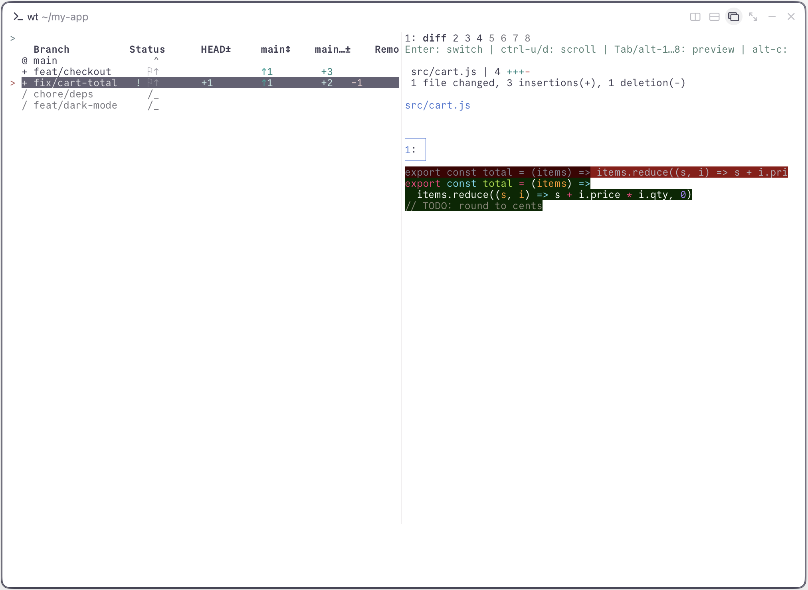

# rex-worktrunk

A [Rex](https://www.superlogical.com/rex) plugin that lists [Worktrunk](https://worktrunk.dev) worktrees in the command palette. It opens the worktree you pick in a new tab of the current session and names the tab after the branch.



## Requirements

- Rex server 0.1.0-preview.21 or later, for command palette prompts (`rex.ui`)
- the `rex` CLI on your `PATH`, because creating a worktree runs `rex window new` to open the tab
- [Worktrunk](https://worktrunk.dev) (`wt`) on your login shell's `PATH`, tested with 0.81.0. Install it with `brew install worktrunk`.

## Install

Clone the repo into your Rex config folder:

```sh
git clone https://github.com/astwys/rex-worktrunk ~/.config/rex/rex-worktrunk
```

Load it from `~/.config/rex/init.lua` and bind a key to the `worktrunk` action:

```lua
require("rex-worktrunk")
rex.bind("ctrl+a>w", "worktrunk")
```

Then run `rex config reload`.

## Usage

Press the key, or pick "Worktrees…" in the command palette. The palette lists the worktrees and local branches of the focused pane's repo, with each worktree's path and Worktrunk's status symbols.

- Pick a branch that has a worktree to open it in a new tab.
- Pick a branch without one, or type a new name and choose it, to have Worktrunk create the worktree. This runs `wt switch` in a floating pane so you can see its hooks, then opens the tab.
- Pick "Remove Worktrees…" in the command palette, tick the worktrees to remove, and press Cmd-Return. The plugin runs `wt remove` on them, which refuses worktrees with uncommitted changes.

To list another repo, pass its path:

```sh
rex do worktrunk cwd=$HOME/code/my-app
rex do worktrunk_remove cwd=$HOME/code/my-app
```

## License

MIT
